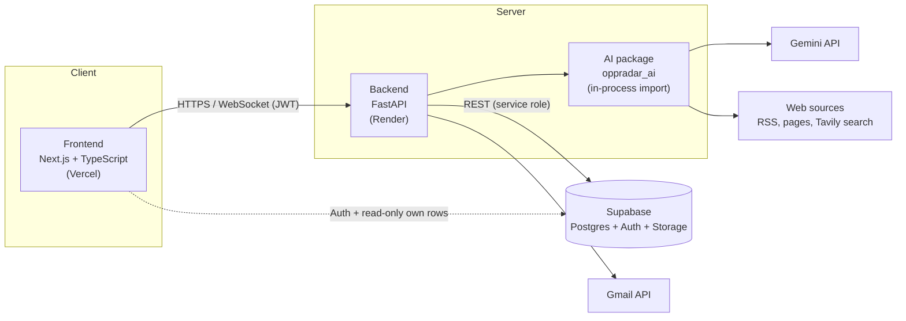

<div align="center">

# OppRadar

**An AI agent that finds, checks and matches opportunities to you, so you stop searching and opportunities find you.**

Scholarships · Jobs · Internships · Hackathons · Funded conferences · International volunteering

[Demo video](https://drive.google.com/file/d/1RvIOs0k2GaWfSor1w4duTqVc0bwel89m/view?usp=sharing) · [App walkthrough](https://shorturl.at/atkAI) · [Documentation](docs/) · [Security review](docs/OppRadar_Security_Review_STRIDE.pdf) · [Technical datasheet](docs/OppRadar_Datasheet.pdf)

</div>

---

## Table of contents

1. [The problem and the idea](#1-the-problem-and-the-idea)
2. [Key features](#2-key-features)
3. [Architecture](#3-architecture)
4. [Technology stack](#4-technology-stack)
5. [Repository layout](#5-repository-layout)
6. [Getting started](#6-getting-started)
7. [Configuration](#7-configuration)
8. [AI package](#8-ai-package)
9. [Security and privacy](#9-security-and-privacy)
10. [Testing, CI and evaluation](#10-testing-ci-and-evaluation)
11. [Deployment](#11-deployment)
12. [Business model](#12-business-model)
13. [Project status and roadmap](#13-project-status-and-roadmap)
14. [Documentation](#14-documentation)
15. [Contributing and Git workflow](#15-contributing-and-git-workflow)
16. [Troubleshooting](#16-troubleshooting)
17. [Team](#17-team)

---

## 1. The problem and the idea

Students, graduates, job seekers and busy professionals spend hours searching for opportunities. What they find on social media is often expired, out of reach, or too expensive. In a survey of 64 students at our school (October 2026):

- **95%** had missed an opportunity because they found out too late.
- **64%** find opportunities mainly on social media.
- **56%** say finding ones that fit their profile is hard.
- **83%** said OppRadar would (probably) solve their problem.

**OppRadar flips the search.** A user builds a profile once (CV, certificates, projects, activities). A background agent scans the web, reads each opportunity, checks eligibility and scams, and notifies the user **only** about opportunities they actually qualify for, with the reasons why.

> The survey covers students at one school. It is a validation signal, not a market study.

## 2. Key features

| Area | What it does |
| --- | --- |
| **Discovery (shared, runs once for everyone)** | Fetches RSS feeds, public pages and web search results, cleans them, extracts a structured `Opportunity` with an LLM, de-duplicates and scam-checks each item. Deadlines are never invented. |
| **Profile** | Parses a CV (PDF, DOCX, TXT, images, with local OCR for scans) into a structured profile. User documents go to a remote model only with explicit consent. |
| **Matching (per user)** | Hard filters, then a 0 to 100 soft score: `0.5 × semantic similarity + 0.35 × criteria ratio + 0.15 × bonus`. Every requirement is marked MET, MISSED or UNKNOWN, and every match carries 1 to 3 plain-language reasons. |
| **Notifications** | Rule-based: threshold, never twice for the same opportunity, digest mode, quiet hours (22:00 to 08:00) and a daily cap. Every suppressed item keeps its reason. |
| **Chat assistant** | Answers questions about an opportunity, grounded in the public record and the requirement verdicts. If it cannot ground an answer it says "not in the source". |
| **Applications** | Save, prepare and track applications through their statuses. |
| **Organisations and admin** | Organisations submit opportunities for review. Admins approve, relabel (for example scam) or delete them at `/admin`. |
| **Premium** | Early-access reservation, no payments yet (see [Business model](#12-business-model)). |
| **Multilingual UI** | English, French and Arabic (right-to-left), with light, dark and system themes. |

## 3. Architecture

Three tiers, one deployable AI. The AI is a plain Python package imported by the backend, so there is no AI microservice to run.



**Design decisions**

- **Deterministic first, LLM second.** Rules do filtering, scoring, scam detection and notification decisions. The LLM is used only where rules cannot read messy text.
- **Shared discovery, cheap per-user matching.** Each opportunity is discovered, read and verified once, then scored against every user's profile.
- **A narrow contract.** Six functions are the whole interface between the backend and the AI package (see [AI package](#8-ai-package)).
- **One door to the AI.** Routers never import `oppradar_ai`. Only `backend/app/services/ai.py` does.
- **Privacy by default.** User documents never go to a remote model without consent, and the model never sees the profile during matching or chat.
- **One LLM client.** Keys, retries and rate limits live in `ai/oppradar_ai/llm.py`.

The full architecture, data flow and error contract are in the [technical datasheet](docs/OppRadar_Datasheet.pdf).

## 4. Technology stack

| Layer | Technology |
| --- | --- |
| Frontend | Next.js (App Router), TypeScript, React Query, next-intl (EN/FR/AR, RTL), Playwright |
| Backend | FastAPI, Pydantic, Socket.IO (live updates), Gmail API (emails) |
| Data | Supabase: Postgres with Row Level Security on every table, Auth, Storage |
| AI | Python package `oppradar_ai`: Gemini (`google-genai`), Tavily search, sentence-transformers (local embeddings), RapidOCR (local OCR), httpx, trafilatura, feedparser, PyMuPDF, pdfplumber, python-docx, rapidfuzz, APScheduler |
| Tooling | pytest, ruff, ESLint, GitHub Actions, Docker Compose |
| Hosting | Vercel (frontend), Render (API), Supabase (database) |

OppRadar runs on **free tiers** (Gemini Flash, Tavily, local libraries). That has consequences: Gemini allows only a few calls per minute and per day, so large ingestion runs may leave items pending until the next run. Nothing is ever fabricated while waiting.

## 5. Repository layout

```
oppradar/
├── frontend/                 Next.js + TypeScript app (messages/<en|fr|ar>/*.json for i18n)
├── backend/                  FastAPI app
│   ├── app/
│   │   ├── routers/          HTTP endpoints and auth dependencies
│   │   ├── services/         business rules, notifications, AI gateway (services/ai.py)
│   │   └── repositories/     SupabaseRepository and MemoryRepository
│   ├── scripts/              seed.py, make_admin.py, export_openapi.py
│   └── tests/                includes test_security.py and test_gmail.py
├── ai/                       the oppradar_ai Python package (standalone, no web framework)
│   ├── oppradar_ai/
│   │   ├── api.py            the six-function contract used by the backend
│   │   ├── schemas.py, llm.py        SHARED: changes need approval from every AI owner
│   │   ├── ingestion/        fetch, clean, extract, dedupe, scam check, sources.yaml
│   │   ├── documents/        CV and document parsing, OCR
│   │   ├── matching/         filters, criteria, scoring, reasons, notifications
│   │   └── chat/             retrieval-grounded assistant
│   ├── notebooks/            experiments, run without the UI (one prefix per person)
│   ├── data/                 fixtures and labelled evaluation sets
│   └── tests/                contract-first pytest suites
├── supabase/
│   ├── migrations/           Postgres schema + RLS (apply in order)
│   └── config.toml           auth settings
├── docs/                     all project documentation (see section 14)
├── .github/workflows/ci.yml  CI
├── docker-compose.yml
└── .env.example              copy to .env, never commit secrets
```

### Who owns what

| Path | Contents | Owner(s) |
| --- | --- | --- |
| `frontend/`, `backend/`, `supabase/` | Web app, API, database, deployment, security | Riad |
| `ai/oppradar_ai/ingestion/`, `documents/`, `matching/`, agent and notebooks | Fetching, extraction, CV parsing, scoring, background agent | Ahlem |
| `ai/oppradar_ai/chat/` | Chat assistant | Ikbel |
| `ai/oppradar_ai/schemas.py`, `llm.py` | **Shared** AI code | Riad, Ahlem, Ikbel |
| `docs/` | Documentation | All |

## 6. Getting started

### Prerequisites

- Python 3.11 or newer, Node.js 20 or newer, Git
- A free [Supabase](https://supabase.com) project (optional for the AI package and for `DATA_BACKEND=memory`)
- A free Gemini API key (only for live LLM calls; everything works offline on canned data without it)

### 1. Clone and configure

```bash
git clone <repo-url> oppradar && cd oppradar
cp .env.example .env          # fill in your keys; see Configuration
```

### 2. AI package (standalone)

```bash
cd ai
python -m venv .venv && source .venv/bin/activate   # Windows: .venv\Scripts\activate
pip install -e ".[dev]"
pytest                                              # offline, fake LLM provider
```

With `LLM_PROVIDER=fake` (the default) every function works offline. To make real calls, set `LLM_PROVIDER=gemini`, `GEMINI_API_KEY` and `RUN_LIVE_LLM=1`. See [`ai/README.md`](ai/README.md) and the notebooks in `ai/notebooks/`.

### 3. Backend (FastAPI)

```bash
cd backend
python -m venv .venv && source .venv/bin/activate
pip install -r requirements-dev.txt     # installs ../ai in editable mode too
pytest                                  # offline: in-memory repository + fake LLM
ruff check app tests scripts && ruff format --check app tests scripts
uvicorn app.main:app --reload           # http://localhost:8000/docs
```

Without a Supabase project you can still click through the API with `DATA_BACKEND=memory` (data is lost on restart; auth still needs Supabase JWTs).

### 4. Database (Supabase)

Apply the migrations **in order**, with the CLI (`supabase link --project-ref <ref> && supabase db push`) or by pasting each file into the dashboard's **SQL Editor**.

| File | Adds |
| --- | --- |
| `0001_initial_schema.sql` | profiles and onboarding, documents bucket, opportunities, RLS, signup trigger |
| `0002_user_opportunities.sql` | Save / Not interested per user |
| `0003_settings.sql` | alert rules, extra consents, retention, agent settings |
| `0004_notifications.sql` | general notifications (deadline, tip, system, ...) |
| `0005_applications_chat.sql` | tracked applications, chat history links |
| `0006_premium_reservations.sql` | Premium early-access reservations (no payments) |
| `0007_opportunity_review.sql` | admin review notes, organisation contact, own submissions |
| `0008_*` | see `supabase/migrations/` |
| `0009_read_only_client_access.sql` | **security (F1):** removes all direct client writes; the API uses the service role |

Then seed the fixtures and the read-only demo account:

```bash
cd backend && python scripts/seed.py --demo
```

**Admins** review submissions and manage opportunities at `/admin`. Make someone an admin (they log out and back in afterwards):

```bash
cd backend && python scripts/make_admin.py you@example.com    # --revoke to undo
```

The role lives in `app_metadata`, which users cannot change themselves. Auth settings (email confirmation, 8-character passwords with a digit, 30-minute reset links, Google sign-in) are in `supabase/config.toml`; on a hosted project set them under Authentication in the dashboard.

### 5. Frontend (Next.js)

```bash
cd frontend
npm install
npm run dev                  # http://localhost:3000 (needs the API on :8000)
npm run lint && npm run typecheck && npm run build
npm run i18n:check           # en/fr/ar message files have the same keys
npm run gen:api              # regenerate lib/api/schema.d.ts from the API
npm run e2e                  # Playwright: public pages, API mocked (what CI runs)
npm run e2e:full             # + signed-in journey against your Supabase
```

- `next.config.mjs` reads the repo-root `.env`, so there is no `frontend/.env`.
- After changing backend models, refresh the types: `python backend/scripts/export_openapi.py frontend/lib/api/openapi.json && npm run gen:api`.
- Add every new UI string to **all three** locale files; `npm run i18n:check` (also in CI) catches gaps.
- `npm run e2e:full` creates a throwaway account with the service-role key, walks log in, the 5-step setup, dashboard, save, apply, Applications, Premium and account deletion, and always removes the account.

### 6. Everything in Docker (optional)

```bash
docker compose up --build    # API on :8000, web on :3000
```

Uses the root `.env` (the web image bakes in the `NEXT_PUBLIC_*` values at build time) and your Supabase project, so apply the migrations first. The API image installs CPU-only PyTorch for the AI package.

## 7. Configuration

Copy `.env.example` to `.env` at the repo root. Nothing secret lives in the repo. Every part reads that one file; more AI options are in `ai/.env.example`.

| Variable | Used by | Purpose |
| --- | --- | --- |
| `SUPABASE_URL`, `SUPABASE_ANON_KEY`, `SUPABASE_SERVICE_ROLE_KEY` | backend | Database and auth. **The service-role key never goes to the browser.** |
| `NEXT_PUBLIC_*` | frontend | Public values only |
| `DATA_BACKEND` | backend | `memory` to run without a database |
| `LLM_PROVIDER` | AI | `fake` (default, offline) or `gemini` |
| `GEMINI_API_KEY` | AI | Gemini key (free tier) |
| `RUN_LIVE_LLM` | AI | Cost gate: set to `1` to allow live web and LLM calls |
| `EMBEDDING_MODEL` | AI | Embedding model; production uses `sentence-transformers/paraphrase-multilingual-MiniLM-L12-v2` (about 470 MB, covers AR/FR/EN) because `bge-m3` (2.2 GB) does not fit a 1 GB instance |
| `EMAIL_SECRET` | backend | Signs unsubscribe links. Random, 32+ bytes in production |
| `GMAIL_*`, `MAIL_FROM`, `SUPABASE_EMAIL_HOOK_SECRET` | backend | Gmail sender and the Supabase Send Email hook |
| `CLIENT_IP_HEADER` | backend | Where the real client IP comes from, for rate limits (set at deploy) |
| `CORS_ORIGINS` | backend | The production domain only |
| `AGENT_SCHEDULER` | backend | `1` on the single instance that runs the scheduler |
| `UPLOAD_MAX_PAGES` | backend | Maximum pages per uploaded PDF (default 10) |

## 8. AI package

Two pipelines run independently: **ingestion** (once for everyone) and **matching** (per user).

```
Ingestion:  Fetch → Clean → Extract → Dedupe → Scam check → shared Opportunity table
Matching:   Hard filters → Soft score → Reasons → Notification rules → user's matches
```

- **Cost control.** One LLM call per new record (duplicates removed first), RSS entries batched five per call, disk-cache hits are free, and a 429 turns the item into `pending` for the next run instead of retrying.
- **Scam check.** Cheap deterministic rules produce a 0 to 1 risk score and a trust label (`ok`, `suspicious`, `scam`). The LLM only gives an optional second opinion in the middle band.
- **Sources.** The initial source list is in `ai/oppradar_ai/ingestion/sources.yaml`. Each entry records its access method, status and why it is enabled or disabled. robots.txt is honoured and one failing source never stops a run.

### The backend and AI contract

The backend imports `from oppradar_ai import api`. Six functions are the entire interface:

| Function | Input → output |
| --- | --- |
| `parse_documents` | Files → `Profile` (rules-only by default; `allow_llm=True` only with explicit user consent) |
| `run_ingestion` | Sources → `IngestionReport` (never raises; failures become report entries) |
| `extract_opportunity` | URL, text or image → `Opportunity` |
| `score_user` | Profile and opportunities → ranked `MatchResult` list |
| `decide_notifications` | Matches, preferences, history → `Notification` list |
| `answer` | Message, history, opportunity → `ChatAnswer` |

Anything else inside the package can change freely as long as these signatures and `schemas.py` hold. Expected failures are raised as `ApiError` with a machine-readable code (for example `rejected`, `pending`, `offline`). Details are in section 7 of the [datasheet](docs/OppRadar_Datasheet.pdf).

### Notebooks

`ai/notebooks/` lets the AI work be tested without the UI: setup, document intake, profile builder, ingestion, page extraction, matching and the background agent. Run them in order from `00_setup.ipynb`. Notebooks are stripped of outputs on commit.

## 9. Security and privacy

A STRIDE threat-model review covered the web app, the API, the Supabase schema and the AI integration. It found **11 issues**: **5 fixed** with tests, **2 deployment configuration tasks**, and **4 low-risk items accepted for launch** with follow-ups.

**In place**

- Every API request is checked against a verified Supabase JWT; Socket.IO connections need a valid token and join only their own room.
- Only Supabase can grant the admin role (`app_metadata.role`); admin routes are checked in the API and in the database.
- Row Level Security on every table (enforced by a test). Since migration `0009`, clients cannot write directly: all writes go through the API.
- The read-only demo account is enforced in the API and in the database.
- SSRF protection on pasted links (`netguard.is_public_url`), upload limits (5 MB, 10 pages, PDF signature check), rate limits, daily AI budgets, and a retention purge (chat after 90 days, applications after 12 months for users on that setting).
- Account deletion removes the auth user, the files and every row.
- The service-role key and every secret exist only on the server.

**Privacy**

| Data | Rule |
| --- | --- |
| User documents (CV, certificates) | Never sent to a remote model by default; only with explicit consent stored with the profile |
| Public opportunity pages and feeds | May go to Gemini when the cost gate is open |
| Profile during matching and chat | The model never sees it; embeddings are local |

**Known limits.** Rate limits, the ingestion cooldown and the chat quota are in memory, so they are correct only on one instance (scaling out needs Redis). All demo visitors share one daily AI quota. Accepted follow-ups: auto-published ingestion review (F8), an admin audit trail (F9), generic AI error messages (F10) and a `script-src` Content Security Policy (F11).

Full findings, fixes and the pre-launch checklist: [`docs/OppRadar_Security_Review_STRIDE.pdf`](docs/OppRadar_Security_Review_STRIDE.pdf).

## 10. Testing, CI and evaluation

```bash
pytest ai/tests          # AI package, offline
cd backend && pytest     # backend, in-memory repository + fake LLM
cd frontend && npm run e2e
```

`.github/workflows/ci.yml` runs on pushes to `main` and `develop` and on every pull request, with no secrets:

- **backend**: ruff (lint and format) and pytest
- **frontend**: ESLint, translation check, type-check, production build
- **e2e**: Playwright on the public pages of a production build (API mocked)
- **docker**: builds both images

**Evaluation.** LLM-dependent behaviour is measured on labelled sets in `ai/data/eval/` (extraction F1, scam precision and recall, matching precision@5 and nDCG@5). The labelled sets are still being completed, so **no accuracy figures are claimed yet**.

## 11. Deployment

| Part | Platform | Notes |
| --- | --- | --- |
| Frontend | Vercel | `NEXT_PUBLIC_*` values only |
| API | Render (single instance) | `AGENT_SCHEDULER=1`, `EMBEDDING_MODEL`, `EMAIL_SECRET`, `CLIENT_IP_HEADER`, `CORS_ORIGINS` |
| Database | Supabase | Apply all migrations (including `0009`) |

**Before launch:** set the production environment variables, apply the migrations on the production project, set up the Gmail sender and point Supabase's Send Email hook at `https://<api>/email/auth-hook`, turn on leaked-password protection and email confirmation, and keep only the production redirect URLs. The complete checklist is in the security review.

## 12. Business model

| Plan | Price | What you get |
| --- | --- | --- |
| **Free** | 0 DZD | 3 scans and 5 agent checks a day, CV upload and extraction included, 1 application draft |
| **Premium for students** | 990 DZD/month (8,900 DZD/year), verified student email | Unlimited checks, scans every 30 minutes, 5 parallel application drafts, priority alerts, deep match explanations, calendar export |
| **Premium for everyone** | 1,490 DZD/month | Same features as the student plan |
| **Clubs & Teams** | 3,900 DZD/month for 5 seats | Shared saves, club dashboard, team drafts (after Premium) |
| **Organizations and universities** | Planned | Pay to have their opportunities recommended first, always labelled "sponsored" and shown only to eligible users |

The free tier is limited because the agent depends on LLM quotas. **Payments are not live yet.** Premium is a free early-access reservation. The plan is to integrate Algérie Poste's payment API before launch (other methods under consideration: CIB/EDAHabia cards and BaridiMob).

**Market.** We start in Algeria (37.8 million people online, according to DataReportal), then Africa, then worldwide. Year-one goal: 5,000 users. Sources and the full pitch are in [`docs/OppRadar_Pitch_Deck.pdf`](docs/OppRadar_Pitch_Deck.pdf).

## 13. Project status and roadmap

| Area | Status |
| --- | --- |
| Repo scaffold, CI | Done |
| Database schema | Done: migrations with RLS on every table, client writes closed in `0009` |
| Ingestion (sources, extraction, dedupe, scam check) | Done, with an initial list of verified sources |
| CV parsing and OCR | Done (rules-first, LLM only with consent) |
| Matching and notifications | Done: filters, criteria verdicts, scoring, reasons, notification rules |
| Background agent | Done (scheduled scans, demo mode) |
| Chat assistant | Implemented (Ikbel) |
| Frontend | Done: landing, explore, auth, onboarding, dashboard, opportunity pages, Ask the agent, Apply assistant, Applications, profile, settings, notifications, Premium (coming soon), organisation submissions, admin; EN/FR/AR; light/dark |
| Backend API | Done: auth, onboarding, CV upload, feed, settings, notifications, applications, chat, Premium reservations, submissions and admin review |
| Security review | Done: 5 findings fixed, 2 config tasks, 4 accepted |
| Evaluation sets | In progress: labelled data and metrics still to be filled in |
| Payments | Not started: Algérie Poste integration planned before launch |

**Roadmap (needs your help)**

- Swipe screen: a card deck to accept or reject matches
- Reels feed: alumni and organizers share experiences and announce events
- Organization accounts and analytics for universities and clubs
- Application help, then applying on your behalf with your approval
- Smarter learning from user feedback
- Redis for rate limits when scaling beyond one instance

## 14. Documentation

For more details, read the documents in the [`docs/`](docs/) folder:

| Document | What it covers |
| --- | --- |
| [`OppRadar_Datasheet.pdf`](docs/OppRadar_Datasheet.pdf) | System architecture, technology stack, AI pipeline, the backend and AI contract, data flow, cost gates |
| [`OppRadar_SRS.pdf`](docs/OppRadar_SRS.pdf) | Software requirements: review notes and suggested wording fixes |
| [`OppRadar_Security_Review_STRIDE.pdf`](docs/OppRadar_Security_Review_STRIDE.pdf) | STRIDE threat model, the 11 findings, fixes, and the pre-launch checklist |
| [`OppRadar_Figma_UIUX_Desing.pdf`](docs/OppRadar_Figma_UIUX_Desing.pdf) | Design system, interface screens and slides, with a link to the Figma file |
| [`OppRadar_Brand_Sheet.pdf`](docs/OppRadar_Brand_Sheet.pdf) | Visual identity: logo, colours, typography |
| [`OppRadar_Pitch_Deck.pdf`](docs/OppRadar_Pitch_Deck.pdf) | Problem, solution, market, business model, competition, team and ask |

**Visual identity.** Colours: purple `#8B34FF`, yellow `#FAFC52`, lilac `#F6F2FC`, ink `#1E1D1E`. Typeface: DM Sans.

## 15. Contributing and Git workflow

All work happens on **`develop`**. `main` is reserved for stable releases.

1. Branch off `develop`: `git checkout -b feature/<topic>` (git cannot create `develop/...` branches while a `develop` branch exists).
2. Run the checks for the part you touched (see [Testing](#10-testing-ci-and-evaluation)).
3. Open a pull request **back into `develop`**; CODEOWNERS requests the right reviewer.
4. `ai/oppradar_ai/schemas.py` and `llm.py` are shared: every AI owner must approve changes there. Schema changes between the backend and the AI also need both sides to agree.

Never commit secrets. `data/private/` is git-ignored and holds real user documents used for local testing.

## 16. Troubleshooting

- **Python hangs on start-up (API, tests, seed) on Windows.** If the WMI service is stuck, `platform.system()` blocks forever (Supabase, PyMuPDF and onnxruntime all call it on import). Fix: `Restart-Service Winmgmt -Force` as admin, or reboot.
- **`next build`, ESLint or tests crash with "out of memory".** Check free memory; a long-running `next dev` can grow to several GB, so restart it.
- **"Failed to fetch" in the browser.** Is the API running on port 8000? Unexpected API errors return a JSON 500 with details in the API log.
- **Gemini 429 or very slow calls.** The free tier allows about 5 requests per minute and a small daily quota per model and project. Items become `pending` and are retried on the next run. Use another key or project, or wait for the daily reset.
- **Embedding model download fills the disk or crashes.** `bge-m3` is 2.2 GB. Set `EMBEDDING_MODEL=sentence-transformers/paraphrase-multilingual-MiniLM-L12-v2`.
- **Supabase CLI crashes with "Illegal instruction".** The npm `supabase` CLI 2.109 (Bun build) fails on some CPUs. Use the dashboard SQL Editor or `scoop install supabase`.
- **Notebook errors about duplicate Pydantic classes.** Do not use `%autoreload`; restart the kernel and run all cells.

## 17. Team

| | Role | Contribution |
| --- | --- | --- |
| **Ahlem Toubrinet** | UI/UX and graphic designer, AI engineer | UI/UX design, design system and visual identity; AI pipeline (ingestion, documents, matching, background agent); repository setup and structure; pitch deck |
| **Riad Doukha** | Full-stack developer, marketing strategist, AI engineer | Frontend, backend and database; infrastructure and deployment; AI integration; security review; project documentation and the validation survey |
| **Ikbel Dhif** | AI engineer, multimedia strategist | Chat assistant; user research and survey outreach; testing; demo recording |

Built in three weeks after the ThirdUni course: one week on the idea and problem, two on production.

---

<div align="center">

**OppRadar** · Stop searching. Let opportunities find you.

</div>